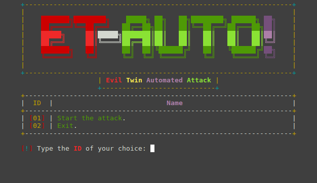

# evil-twin-automated
Automated Evil Twin attack with captive portal, victim traffic monitoring and session logging.

# Screenshot

## Script Requirements
* Linux OS
* [usbutils](https://packages.debian.org/sid/usbutils)
* [pciutils](https://packages.debian.org/sid/pciutils)
* [xterm](https://packages.debian.org/sid/xterm)
* [isc-dhcp-server](https://packages.debian.org/sid/isc-dhcp-server)
* [aircrack-ng](https://www.aircrack-ng.org/doku.php?id=downloads#downloads)
* [hostapd](https://packages.debian.org/sid/hostapd)
* [tcpdump](https://packages.debian.org/sid/tcpdump)
